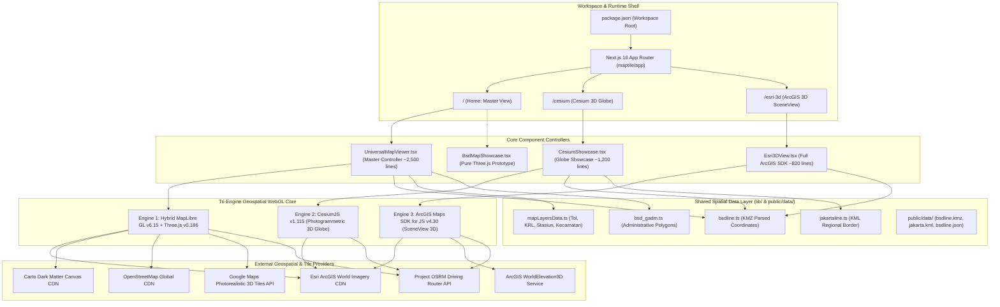
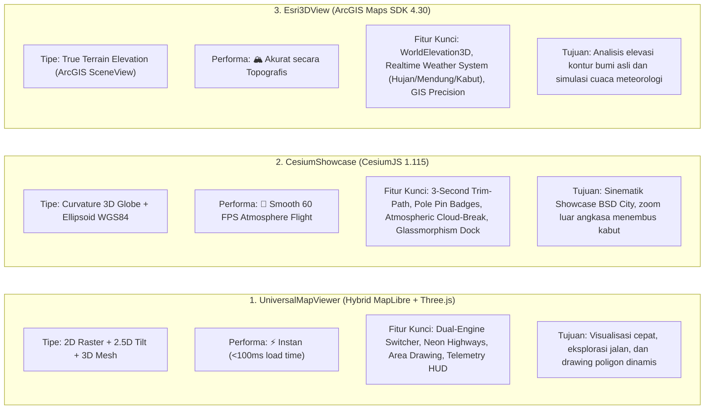
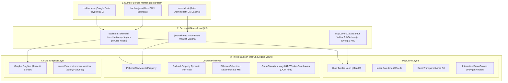
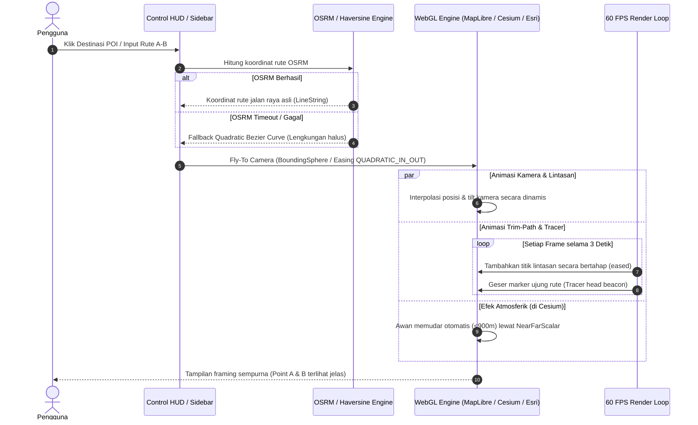

# Master Graphify — Arsitektur Sistem Spindonesia Tiles (Maptiles)

Dokumen ini memetakan seluruh topologi, arsitektur *tri-engine*, alur data geospasial, serta hierarki komponen dari proyek **Maptiles (Spindonesia Tiles)** secara visual dan struktural (**Graphify**).

---

## 1. Topologi Sistem Tingkat Tinggi (Master Architecture Graph)

Aplikasi ini berbasis **Next.js 16 (App Router)** dan **React 19**, mengadopsi arsitektur **Tri-Engine Geospatial Platform** dengan tiga halaman utama yang masing-masing menjalankan engine visualisasi WebGL berbeda di atas lapisan data geospasial (*Spatial Data Layer*) bersama.



---

## 2. Peta Perbandingan Tri-Engine (Tri-Engine Ecosystem Graph)

Diagram ini mengilustrasikan perbedaan arsitektur teknis, kelebihan utama, dan spesialisasi visual dari masing-masing engine:



---

## 3. Alur Data Geospasial & Pipeline Lapisan (Spatial Pipeline Graph)

Bagian ini memetakan bagaimana data mentah dari format **KMZ / KML / GeoJSON** diproses menjadi objek grafis di atas canvas WebGL:



---

## 4. Alur Interaksi State & Animasi (Sequence Graph)

Diagram ini menggambarkan alur saat pengguna berinteraksi dengan fitur navigasi, pemilihan rute, dan animasi *motion-graphics*:



---

## 5. Matriks Fitur Lengkap Berdasarkan Rute

| Indikator | `/` (UniversalMapViewer) | `/cesium` (CesiumShowcase) | `/esri-3d` (Esri3DView) |
| :--- | :--- | :--- | :--- |
| **URL / Halaman** | [`maptile/app/page.tsx`](file:///C:/Users/epicyoung/Desktop/VIBECODE/Maptiles/maptile/app/page.tsx) | [`maptile/app/cesium/page.tsx`](file:///C:/Users/epicyoung/Desktop/VIBECODE/Maptiles/maptile/app/cesium/page.tsx) | [`maptile/app/esri-3d/page.tsx`](file:///C:/Users/epicyoung/Desktop/VIBECODE/Maptiles/maptile/app/esri-3d/page.tsx) |
| **Komponen Utama**| [`UniversalMapViewer.tsx`](file:///C:/Users/epicyoung/Desktop/VIBECODE/Maptiles/maptile/components/UniversalMapViewer.tsx) | [`CesiumShowcase.tsx`](file:///C:/Users/epicyoung/Desktop/VIBECODE/Maptiles/maptile/components/CesiumShowcase.tsx) | [`Esri3DView.tsx`](file:///C:/Users/epicyoung/Desktop/VIBECODE/Maptiles/maptile/components/Esri3DView.tsx) |
| **Teknologi Render**| MapLibre GL 6.15 + Three.js 0.186 | CesiumJS 1.115 (CDN) | ArcGIS JavaScript API 4.30 (CDN) |
| **Bentuk Dunia** | Proyeksi Flat / 2.5D Pitch + 3D Tiles | 3D Curved Globe (WGS84 Ellipsoid) | 3D Curved Globe + Elevation Layer |
| **Sumber Citra** | Esri, Carto Dark, OSM, Google 3D | Esri World Imagery | Esri World Imagery |
| **Sistem Awan** | 3D Glowing Tubes Boundary | Atmospheric Cloud-Break (Near/Far Mist) | ArcGIS Native Cloudy/Rain/Fog Weather |
| **Animasi Rute** | Continuous 60fps Tracer Beacon | 3-Second Trim-Path Draw + Ping Head | Progressive Polyline Draw |
| **Drawing Tool** | Polygon Area Measure & Draw | — | — |
| **Dukungan Data** | BSD Boundary, Tol, KRL, Stasiun | BSD KMZ Border, POI Pins 3D | BSD Preset POI, World Elevation |

---

## 6. Hierarki Direktori & Modul Berkas

```
Maptiles/
├── package.json                         # Workspace monorepo root
├── GRAPHIFY.md                          # Master Graphify & Dokumentasi Arsitektur
├── maptile/                             # Next.js 16 Web Application
│   ├── GRAPHIFY.md                      # Salinan dokumentasi di subfolder maptile
│   ├── next.config.ts                   # Turbopack, experiments, origins
│   ├── app/
│   │   ├── layout.tsx                   # HTML & global metadata shell
│   │   ├── globals.css                  # Tailwind CSS v4 styling
│   │   ├── page.tsx                     # Rute utama (UniversalMapViewer)
│   │   ├── cesium/
│   │   │   └── page.tsx                 # Rute showcase Cesium Globe
│   │   └── esri-3d/
│   │       └── page.tsx                 # Rute showcase ArcGIS SceneView
│   ├── components/
│   │   ├── UniversalMapViewer.tsx       # Master Controller (MapLibre + Three.js)
│   │   ├── CesiumShowcase.tsx           # Cesium 3D Globe Showcase
│   │   ├── Esri3DView.tsx               # ArcGIS Maps SDK SceneView
│   │   └── BsdMapShowcase.tsx           # Standalone pure Three.js Google 3D
│   ├── lib/
│   │   ├── bsdline.ts                   # Koordinat poligon BSDEPICYOUNG
│   │   ├── bsd_gadm.ts                  # Data spasial GADM BSD
│   │   ├── jakartaline.ts               # Koordinat batas DKI Jakarta
│   │   └── mapLayersData.ts             # Jaringan jalan tol, KRL, stasiun, kecamatan
│   └── public/
│       └── data/                        # Asset mentah KMZ, KML, dan GeoJSON
```

---

## 7. Saran Pengembangan Arsitektur Lanjutan

> [!TIP]
> Sekarang proyek Maptiles telah memiliki **3 engine visualisasi kelas dunia** yang berjalan harmonis dalam satu aplikasi Next.js 16.

Peluang optimasi selanjutnya yang dapat diterapkan:
1. **Shared Navigation Dock**: Mengintegrasikan navigasi universal agar pengguna dapat berpindah antar ketiga engine (`/`, `/cesium`, `/esri-3d`) secara instan tanpa me-reload aset dasar.
2. **Dynamic KMZ Uploader**: Menambahkan fitur *drag-and-drop* file `.kmz` / `.kml` langsung dari browser ke peta untuk divisualisasikan otomatis di ketiga engine.
3. **Environment Variable**: Memusatkan token API (Google Cloud API Key, Cesium Ion Token, ArcGIS API Key) ke `.env.local` agar terisolasi dengan aman dari *client bundle*.
